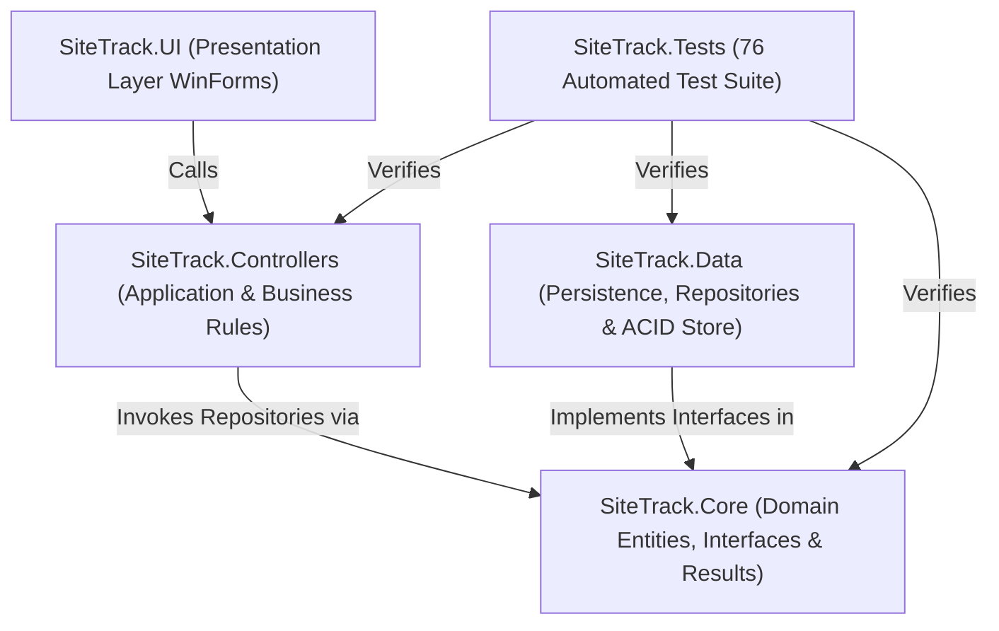

Here is a comprehensive **Codebase Navigation & Architecture Presentation Guide** designed to help you explain every layer, file, pattern, and business rule of **SiteTrack** to your lecturer with confidence.

---

### 1. High-Level Architectural Blueprint

SiteTrack is designed using the **MVC (Model-View-Controller)** pattern combined with the **Repository Pattern** and **Dependency Inversion**. The solution [`SiteTrack.sln`](file:///d:/Projects/AUCA/Class/Dotnet/Lab%203/SiteTrack.sln) contains **5 cleanly decoupled projects**:



---

### 2. Solution Project Breakdown: Where Everything Lives

#### A. Core Layer — [`src/SiteTrack.Core`](file:///d:/Projects/AUCA/Class/Dotnet/Lab%203/src/SiteTrack.Core) (Zero Dependencies)
*This is the domain core. It has zero dependencies on Windows Forms, System.Web, or SQL drivers.*
- **POCO Domain Models** ([`src/SiteTrack.Core/Models/`](file:///d:/Projects/AUCA/Class/Dotnet/Lab%203/src/SiteTrack.Core/Models)):
  - [`User.cs`](file:///d:/Projects/AUCA/Class/Dotnet/Lab%203/src/SiteTrack.Core/Models/User.cs): User entities, RBAC roles (`Administrator`, `SiteManager`), account status (`ACTIVE`, `INACTIVE`).
  - [`Project.cs`](file:///d:/Projects/AUCA/Class/Dotnet/Lab%203/src/SiteTrack.Core/Models/Project.cs): Multi-site registry, timelines, and `ProjectActivity` model.
  - [`Material.cs`](file:///d:/Projects/AUCA/Class/Dotnet/Lab%203/src/SiteTrack.Core/Models/Material.cs): Material categories and master catalog items.
  - [`StockModels.cs`](file:///d:/Projects/AUCA/Class/Dotnet/Lab%203/src/SiteTrack.Core/Models/StockModels.cs): Stock balances, purchases, usage logs, and immutable `MaterialStockMovement` (IN/OUT/ADJUSTMENT).
  - [`LaborModels.cs`](file:///d:/Projects/AUCA/Class/Dotnet/Lab%203/src/SiteTrack.Core/Models/LaborModels.cs): Worker types, site workers, daily attendance (`PRESENT`/`ABSENT`), and attendance-gated payment vouchers.
  - [`ReportModels.cs`](file:///d:/Projects/AUCA/Class/Dotnet/Lab%203/src/SiteTrack.Core/Models/ReportModels.cs) & [`NotificationModels.cs`](file:///d:/Projects/AUCA/Class/Dotnet/Lab%203/src/SiteTrack.Core/Models/NotificationModels.cs): Aggregated metrics, low-stock alerts, and audit logs.
- **Contract Interfaces** ([`src/SiteTrack.Core/Interfaces/IRepositories.cs`](file:///d:/Projects/AUCA/Class/Dotnet/Lab%203/src/SiteTrack.Core/Interfaces/IRepositories.cs)):
  - Defines `IUserRepository`, `IProjectRepository`, `IMaterialRepository`, `IStockRepository`, `ILaborRepository`, and `IReportRepository`.
- **Result Pattern** ([`src/SiteTrack.Core/Result.cs`](file:///d:/Projects/AUCA/Class/Dotnet/Lab%203/src/SiteTrack.Core/Result.cs)):
  - Standardizes operation responses (`Result` and `Result<T>`) to return success/failure messages gracefully without throwing unhandled exceptions across architectural boundaries.
- **Security & Password Hashing** ([`src/SiteTrack.Core/Security/PasswordHasher.cs`](file:///d:/Projects/AUCA/Class/Dotnet/Lab%203/src/SiteTrack.Core/Security/PasswordHasher.cs)):
  - Implements salted **SHA-256 cryptographic hashing** and timing-safe verification.
- **CSV Export Engine** ([`src/SiteTrack.Core/CsvExporter.cs`](file:///d:/Projects/AUCA/Class/Dotnet/Lab%203/src/SiteTrack.Core/CsvExporter.cs)):
  - RFC 4180 CSV serializer saving with **UTF-8 Byte Order Mark (BOM)** so Excel renders special characters without encoding errors.

---

#### B. Data Layer — [`src/SiteTrack.Data`](file:///d:/Projects/AUCA/Class/Dotnet/Lab%203/src/SiteTrack.Data) (Persistence & Repositories)
*Implements repository contracts with thread-safe ACID guarantees and provides SQL schema scripts.*
- **Connection Factory** ([`src/SiteTrack.Data/Connection/DbConnectionFactory.cs`](file:///d:/Projects/AUCA/Class/Dotnet/Lab%203/src/SiteTrack.Data/Connection/DbConnectionFactory.cs)):
  - Manages database provider abstractions and connectivity checks.
- **ACID In-Memory Relational Engine** ([`src/SiteTrack.Data/Connection/SiteTrackDataStore.cs`](file:///d:/Projects/AUCA/Class/Dotnet/Lab%203/src/SiteTrack.Data/Connection/SiteTrackDataStore.cs)):
  - Thread-safe repository engine backed by `SyncRoot` locks and seeded with realistic Rwandan construction sites, workers, and inventory.
- **Concrete Repositories** ([`src/SiteTrack.Data/Repositories/`](file:///d:/Projects/AUCA/Class/Dotnet/Lab%203/src/SiteTrack.Data/Repositories)):
  - [`StockRepository.cs`](file:///d:/Projects/AUCA/Class/Dotnet/Lab%203/src/SiteTrack.Data/Repositories/StockRepository.cs): Implements stock replenishment, moving weighted average updates, and depletion guards.
  - [`LaborRepository.cs`](file:///d:/Projects/AUCA/Class/Dotnet/Lab%203/src/SiteTrack.Data/Repositories/LaborRepository.cs): Worker rosters, daily attendance upserts, and attendance-gated payment vouchers.
  - [`ProjectRepository.cs`](file:///d:/Projects/AUCA/Class/Dotnet/Lab%203/src/SiteTrack.Data/Repositories/ProjectRepository.cs): Project management, site manager assignments, and referential integrity protection.
  - [`UserRepository.cs`](file:///d:/Projects/AUCA/Class/Dotnet/Lab%203/src/SiteTrack.Data/Repositories/UserRepository.cs): Credential validation, user status, and duplicate guards.
  - [`MaterialRepository.cs`](file:///d:/Projects/AUCA/Class/Dotnet/Lab%203/src/SiteTrack.Data/Repositories/MaterialRepository.cs): Categories and master catalog maintenance.
  - [`ReportRepository.cs`](file:///d:/Projects/AUCA/Class/Dotnet/Lab%203/src/SiteTrack.Data/Repositories/ReportRepository.cs): Expenditure rollups and low-stock detection.
- **SQL Migration Scripts**:
  - 16-Table 3NF Schema: [`docs/001_initial_schema.sql`](file:///d:/Projects/AUCA/Class/Dotnet/Lab%203/docs/001_initial_schema.sql)
  - Comprehensive Seed Data: [`docs/002_seed_data.sql`](file:///d:/Projects/AUCA/Class/Dotnet/Lab%203/docs/002_seed_data.sql)

---

#### C. Controllers Layer — [`src/SiteTrack.Controllers`](file:///d:/Projects/AUCA/Class/Dotnet/Lab%203/src/SiteTrack.Controllers) (Business Logic)
*Orchestrates transactions and enforces all technical and academic business rules.*
- [`BaseController.cs`](file:///d:/Projects/AUCA/Class/Dotnet/Lab%203/src/SiteTrack.Controllers/BaseController.cs): Holds active user session, `IsAdmin`, `CurrentUserId`, and RBAC context.
- [`AuthController.cs`](file:///d:/Projects/AUCA/Class/Dotnet/Lab%203/src/SiteTrack.Controllers/AuthController.cs): Authenticates username/password, blocks inactive accounts, and establishes user session.
- [`UserController.cs`](file:///d:/Projects/AUCA/Class/Dotnet/Lab%203/src/SiteTrack.Controllers/UserController.cs): User provisioning (Admin only, minimum 6-character passwords, prevents self-deactivation).
- [`ProjectController.cs`](file:///d:/Projects/AUCA/Class/Dotnet/Lab%203/src/SiteTrack.Controllers/ProjectController.cs): Date validation (End Date $\ge$ Start Date), site manager assignments, and delete protection.
- [`StockController.cs`](file:///d:/Projects/AUCA/Class/Dotnet/Lab%203/src/SiteTrack.Controllers/StockController.cs): Purchases, stock reconciliations, and material consumption.
- [`LaborController.cs`](file:///d:/Projects/AUCA/Class/Dotnet/Lab%203/src/SiteTrack.Controllers/LaborController.cs): Worker registration, attendance logging, and payment authorization.
- [`ActivityController.cs`](file:///d:/Projects/AUCA/Class/Dotnet/Lab%203/src/SiteTrack.Controllers/ActivityController.cs): Daily progress logging strictly bounded between `0%` and `100%`.
- [`ReportController.cs`](file:///d:/Projects/AUCA/Class/Dotnet/Lab%203/src/SiteTrack.Controllers/ReportController.cs): Aggregates material consumption, labor wage sheets, and movement ledgers.

---

#### D. UI Layer — [`src/SiteTrack.UI`](file:///d:/Projects/AUCA/Class/Dotnet/Lab%203/src/SiteTrack.UI) (Presentation WinForms)
- **Application Entry Point** ([`src/SiteTrack.UI/Program.cs`](file:///d:/Projects/AUCA/Class/Dotnet/Lab%203/src/SiteTrack.UI/Program.cs)):
  - Launches `FormLogin`. Upon `DialogResult.OK`, displays `FormMainShell`. If the user clicks *Sign Out*, it loops back to `FormLogin` cleanly.
- **Main Shell Window** ([`src/SiteTrack.UI/Forms/FormMainShell.cs`](file:///d:/Projects/AUCA/Class/Dotnet/Lab%203/src/SiteTrack.UI/Forms/FormMainShell.cs)):
  - Fixed reverse z-order docking layout:
    - Sidebar (`pnlSidebar` on Left): Logo at top, navigation buttons in center, Sign Out at bottom.
    - Header (`pnlHeader` on Top): Title, subtitle, and user role badge.
    - Status Strip at bottom: Database connection and user session indicator.
    - Main Content (`pnlContent` Fill): Dynamically swaps UserControls without UI flicker.
  - Enforces UI gating (hides `btnNavUsers` if the authenticated user is not an Admin).
- **Interactive UserControls (Views)** ([`src/SiteTrack.UI/Controls/`](file:///d:/Projects/AUCA/Class/Dotnet/Lab%203/src/SiteTrack.UI/Controls)):
  - `CreateDashboardView()` in [`FormMainShell.cs`](file:///d:/Projects/AUCA/Class/Dotnet/Lab%203/src/SiteTrack.UI/Forms/FormMainShell.cs#L365): Real-time KPI tiles (Active Projects, Low Stock alerts, Workers on Site, Total Material & Labor Expenditure).
  - [`UcProjects.cs`](file:///d:/Projects/AUCA/Class/Dotnet/Lab%203/src/SiteTrack.UI/Controls/UcProjects.cs): Multi-site registry with site manager assignment dialogs.
  - [`UcStock.cs`](file:///d:/Projects/AUCA/Class/Dotnet/Lab%203/src/SiteTrack.UI/Controls/UcStock.cs) & [`UcMaterials.cs`](file:///d:/Projects/AUCA/Class/Dotnet/Lab%203/src/SiteTrack.UI/Controls/UcMaterials.cs): Inventory ledger, low-stock highlights, purchase entries, and usage modal.
  - [`UcLabor.cs`](file:///d:/Projects/AUCA/Class/Dotnet/Lab%203/src/SiteTrack.UI/Controls/UcLabor.cs): Worker directory, daily attendance register, and payment voucher dispatch.
  - [`UcActivities.cs`](file:///d:/Projects/AUCA/Class/Dotnet/Lab%203/src/SiteTrack.UI/Controls/UcActivities.cs): Progress % timeline with visual badges.
  - [`UcUsers.cs`](file:///d:/Projects/AUCA/Class/Dotnet/Lab%203/src/SiteTrack.UI/Controls/UcUsers.cs): User credentials and active/deactivated toggles.
  - [`UcReports.cs`](file:///d:/Projects/AUCA/Class/Dotnet/Lab%203/src/SiteTrack.UI/Controls/UcReports.cs): Material usage, labor costs, stock movement audit reports, CSV export, and PDF preview.
- **Reporting & Printing Engine** ([`src/SiteTrack.UI/Export/PrintReportHelper.cs`](file:///d:/Projects/AUCA/Class/Dotnet/Lab%203/src/SiteTrack.UI/Export/PrintReportHelper.cs)):
  - Pure GDI+ `PrintDocument` engine that renders multi-page tables, headers, footers, page counts, and launches standard Windows Print Preview (allowing direct export to PDF).

---

#### E. Test Suite Layer — [`src/SiteTrack.Tests`](file:///d:/Projects/AUCA/Class/Dotnet/Lab%203/src/SiteTrack.Tests) (Verification)
- Automated Test Suite ([`src/SiteTrack.Tests/Program.cs`](file:///d:/Projects/AUCA/Class/Dotnet/Lab%203/src/SiteTrack.Tests/Program.cs)):
  - **76 Automated Tests, 76 Passed, 0 Failed**.
  - Verifies all business rules, technical constraints, controllers, repository queries, and end-to-end multi-site workflows.

---

### 3. Lecturer "Cheat Sheet": Exactly Where Key Rules Live

When your lecturer asks: *"Show me the code where you enforced X"*, direct them to these lines:

| Academic / Business Rule | File Location | Code Explanation |
| :--- | :--- | :--- |
| **1. Depletion Guard** *(Cannot consume more than available stock)* | [`StockRepository.cs#L129-L134`](file:///d:/Projects/AUCA/Class/Dotnet/Lab%203/src/SiteTrack.Data/Repositories/StockRepository.cs#L129-L134) | `if (stock == null \|\| stock.QuantityAvailable < usage.QuantityUsed)` throws a `ValidationException`. |
| **2. Perpetual Moving Weighted Average** *(Stock valuation on purchase)* | [`StockRepository.cs#L86-L92`](file:///d:/Projects/AUCA/Class/Dotnet/Lab%203/src/SiteTrack.Data/Repositories/StockRepository.cs#L86-L92) | `totalCost = (currentQty * currentAvgPrice) + (newQty * newPrice);`<br>`stock.AverageUnitPrice = totalCost / totalQty;` |
| **3. Attendance-Gated Wage Payment** *(Cannot pay worker if ABSENT)* | [`LaborRepository.cs#L280-L286`](file:///d:/Projects/AUCA/Class/Dotnet/Lab%203/src/SiteTrack.Data/Repositories/LaborRepository.cs#L280-L286) | Checks `attendance.IsPresent`. Throws validation exception if worker was marked `ABSENT` on that date. |
| **4. Site Manager Scoping** *(Site Managers only see their assigned sites)* | [`BaseController.cs#L15`](file:///d:/Projects/AUCA/Class/Dotnet/Lab%203/src/SiteTrack.Controllers/BaseController.cs#L15) & [`ActivityController.cs#L43`](file:///d:/Projects/AUCA/Class/Dotnet/Lab%203/src/SiteTrack.Controllers/ActivityController.cs#L43) | Gated by `CanAccessProject(projectId)`. If user is a Site Manager, they are blocked from modifying unassigned projects. |
| **5. Activity Progress Bounds** *(Progress % strictly between 0 and 100)* | [`ActivityController.cs#L54-L58`](file:///d:/Projects/AUCA/Class/Dotnet/Lab%203/src/SiteTrack.Controllers/ActivityController.cs#L54-L58) | `if (progressPercentage < 0 \|\| progressPercentage > 100)` returns `Result.Failure()`. |
| **6. Project Date Validity** *(End Date must be $\ge$ Start Date)* | [`ProjectController.cs#L73`](file:///d:/Projects/AUCA/Class/Dotnet/Lab%203/src/SiteTrack.Controllers/ProjectController.cs#L73) | `if (expectedEndDate.Value < startDate)` returns `Result.Failure()`. |
| **7. Delete Referential Integrity Guard** *(Cannot delete project with child records)* | [`ProjectController.cs#L161-L165`](file:///d:/Projects/AUCA/Class/Dotnet/Lab%203/src/SiteTrack.Controllers/ProjectController.cs#L161-L165) | Calls `_projectRepository.HasActiveChildRecords(id)` before allowing deletion. |
| **8. Password Security** *(Salted SHA-256 Hashing)* | [`PasswordHasher.cs#L18`](file:///d:/Projects/AUCA/Class/Dotnet/Lab%203/src/SiteTrack.Core/Security/PasswordHasher.cs#L18) | Generates a 16-byte cryptographic salt and computes `SHA256Managed` hash. |

---

### 4. End-to-End Data Flow (How to Walk the Lecturer Through an Action)

When asked: *"Trace what happens when a Site Manager records Material Usage"*:
1. **User Action**: On [`UcStock.cs`](file:///d:/Projects/AUCA/Class/Dotnet/Lab%203/src/SiteTrack.UI/Controls/UcStock.cs), user clicks **"Record Material Usage"**, opening [`FormUsageDialog.cs`](file:///d:/Projects/AUCA/Class/Dotnet/Lab%203/src/SiteTrack.UI/Forms/Dialogs/FormUsageDialog.cs).
2. **UI Submission**: Form collects `ProjectId`, `MaterialId`, `QuantityUsed`, `ActivityDescription`.
3. **Controller Processing**: Calls [`StockController.RecordUsage(...)`](file:///d:/Projects/AUCA/Class/Dotnet/Lab%203/src/SiteTrack.Controllers/StockController.cs):
   - Verifies user is authorized for that project (`CanAccessProject`).
   - Validates positive quantity ($> 0$).
4. **Data Layer Execution**: Calls [`StockRepository.RecordUsage(...)`](file:///d:/Projects/AUCA/Class/Dotnet/Lab%203/src/SiteTrack.Data/Repositories/StockRepository.cs):
   - Acquires `lock (_store.SyncRoot)`.
   - Checks **Depletion Guard**: ensures `QuantityAvailable >= QuantityUsed`.
   - Decrements stock balance: `stock.QuantityAvailable -= usage.QuantityUsed`.
   - Creates an immutable audit record in `material_stock_movements` with `MovementType = "OUT"`.
5. **Return Flow**: Returns `Result<int>.Success(id)` back to the UI, which displays a green success confirmation and reloads the grid without re-querying the whole database.

---

### 5. Step-by-Step Demonstration Script for Presentation

1. **Show the Automated Test Suite** (Proves 100% code correctness first):
   ```powershell
   .\src\SiteTrack.Tests\bin\Release\SiteTrack.Tests.exe
   ```
   *Point out: "Here are our 76 automated tests covering all business rules, data models, and edge cases, all passing with zero errors."*

2. **Launch the Application**:
   ```powershell
   .\src\SiteTrack.UI\bin\Release\SiteTrack.exe
   ```

3. **Demonstrate Role-Based Access Control (RBAC)**:
   - Click the demo button **"Admin (admin)"** $\rightarrow$ Show that **User Management** is visible in the sidebar and all sites are accessible.
   - Click **"Sign Out"** at the bottom of the sidebar.
   - Click the demo button **"Site Mgr (sitemgr)"** $\rightarrow$ Point out that **User Management** is completely hidden, and project dropdowns are strictly locked to *Kigali Heights Commercial Complex*.

4. **Demonstrate Business Rules Live**:
   - Go to **Materials & Stock** $\rightarrow$ Click **"Record Material Usage"** $\rightarrow$ Attempt to request an amount larger than available stock $\rightarrow$ Show the red validation banner: *"Material usage rejected: Insufficient stock"*.
   - Go to **Labor & Attendance** $\rightarrow$ Show that wage payments can only be processed for workers whose daily attendance is marked **`PRESENT`**.
   - Go to **Reports & Export** $\rightarrow$ Click **"Print Preview / PDF"** to display the GDI+ paginated print preview dialog, or click **"Export CSV"** to generate an Excel-ready UTF-8 BOM file.